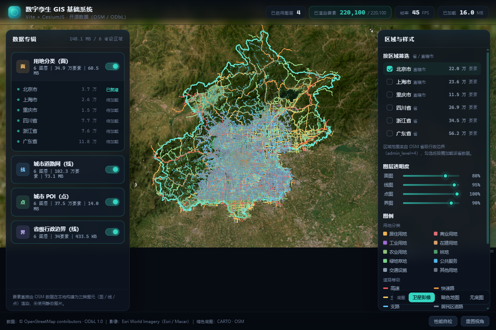
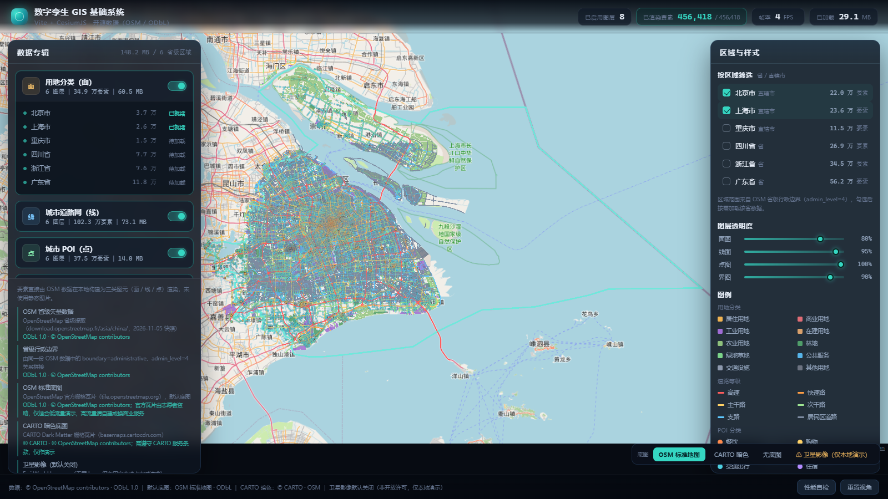
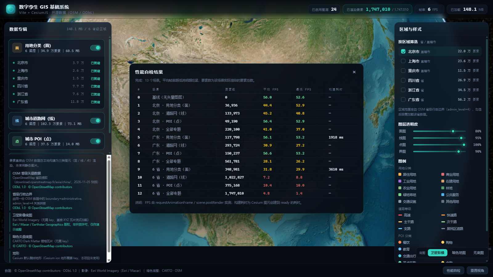
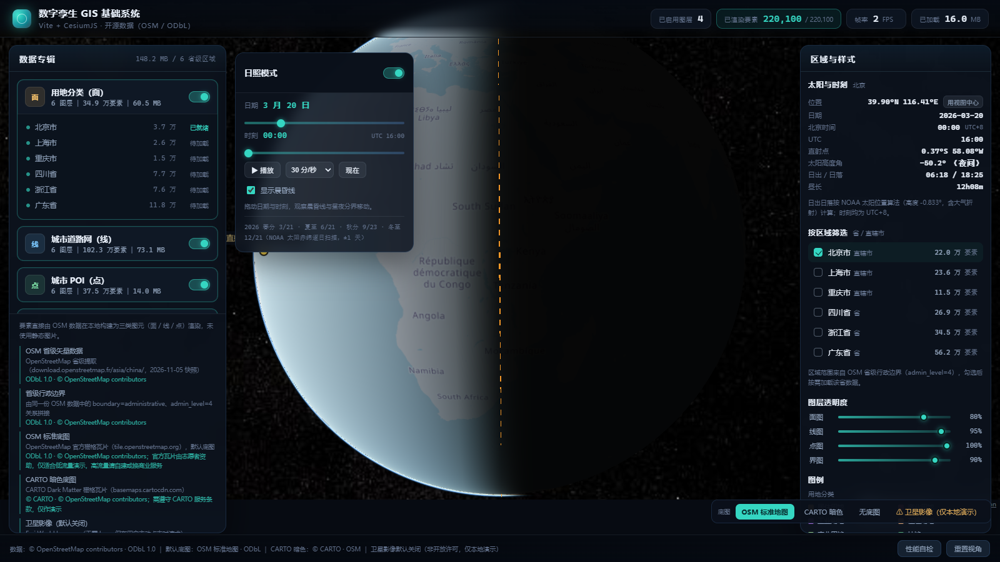
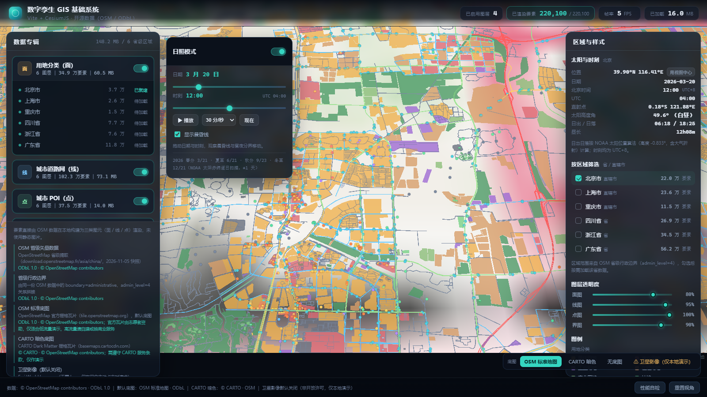
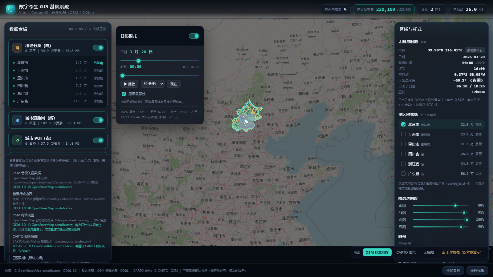

# 数字孪生 GIS 基础系统（开源数据版）

参照《数字孪生技术已经不是门槛-2小时建站过程》的形态，用 **Vite + CesiumJS + OpenStreetMap 开源数据** 复现一套可运行的
数字孪生 GIS 基础系统。原文中的 LCC Web SDK 属于自研封装、公开渠道无法获取，本项目使用 CesiumJS 原生能力实现等价能力。

- 在线演示：https://chengkun1997.github.io/digital-twin-gis/
- 源码：https://github.com/Chengkun1997/digital-twin-gis



## 1. 快速开始

> **仓库不包含矢量数据**（`public/data/*.json` 约 148 MB，`.gitignore` 已排除）。
> 推荐用 GitHub Release 上的固定快照数据包一键获取，不需要联网重建。

```bash
npm install
npm run data:download   # 从 Release 下载数据包（42.6 MB）并解压到 public/data
npm run dev             # http://localhost:5173
```

数据包信息：

| 项 | 值 |
| --- | --- |
| Release tag | `data-2026-11-05` |
| 资产名 | `digital-twin-gis-data-2026-11-05.zip` |
| 压缩包 / 解压后 | 42.6 MB / 148.2 MB（25 个 JSON） |
| 数据快照 | OpenStreetMap 2026-11-05（ODbL 1.0） |

脚本行为说明：

- **私有仓库认证**：优先调用 `gh release download`（复用它已登录的凭据）；若 `gh` 不可用或未登录，回退到用 `GH_TOKEN` / `GITHUB_TOKEN` 调 GitHub API 下载资产（会自动处理 302 跳转，跳转后不带 Authorization）；
- 已有数据时自动跳过，`npm run data:download -- --force` 强制重下；
- 解压后自动校验：`manifest.json` 可解析、6 个区域的 24 个专题文件齐全、**每个文件的实际要素数与 manifest 声明一致**，任一不通过都会报错退出；
- 解压用 `adm-zip`（纯 JS），不依赖系统 `unzip` / `tar`，Windows PowerShell 下可直接运行。

生产构建与静态部署：

```bash
npm run build        # 产物在 dist/（含 Cesium 静态资源与 data/）
npm run preview      # 本地预览构建产物
```

`dist/` 是完全静态的，可放到任意静态服务器（Nginx / OSS / GitHub Pages / `npx serve dist`）。
Vite 使用相对路径 `base: './'`，因此支持部署在子目录下，无需额外配置。

构建产物实测约 **160 MB**：`data/` 148 MB（矢量数据）+ `cesium/` 约 11 MB（Cesium Workers/Assets/Widgets）+ `assets/` 约 5 MB（Cesium 主包 4.9 MB，gzip 后 1.35 MB）。
注意 `main.js` 使用了顶层 `await`，`vite.config.js` 里已把 `build.target` 设为 `esnext`（否则默认 es2020 目标会报错）。

### 部署到 GitHub Pages

采用 **GitHub Actions 构建并发布**（工作流 `.github/workflows/pages.yml`），而不是本地构建后推 `gh-pages` 分支：

- 数据不进仓库也不进分支历史，CI 里用仓库自带的 `GITHUB_TOKEN` 执行 `npm run data:download`，从本仓库 Release 拉取 42.6 MB 数据包；
- 构建与发布都在 Actions 内完成，`gh-pages` 分支不需要存在，也不会让仓库多出 160 MB/次的构建历史；
- 站点地址：`https://chengkun1997.github.io/digital-twin-gis/`。

子路径部署要点（已实测）：Vite `base: './'` + `window.CESIUM_BASE_URL = import.meta.env.BASE_URL + 'cesium/'`
（即 `./cesium/`），两者都以文档 URL 为基准解析，因此在 `/digital-twin-gis/` 子路径下
Cesium 的 `Workers/`、`Assets/`、`Widgets/` 与 `data/*.json` 都能正确命中，不走 404。

线上实测（无头 Chrome 打开线上地址，非仅看 Actions 状态）：北京 4 个专题就绪 / 220,100 要素，
点击上海后 8 个专题 / 456,418 要素渲染完成，**页面请求失败数 0、控制台错误 0**。



GitHub Pages 限制（与本项目对照）：单个发布站点 ≤ 1 GB、单文件 ≤ 100 MB。本项目 `dist/` 共 159.7 MB，
最大单文件 `guangdong-landuse.json` 18.7 MB，均在限制内。


## 2. 功能对照

| 原文能力 | 本项目实现 | 说明 |
| --- | --- | --- |
| 左侧「数据专辑」面板 | ✅ | 4 个专辑：用地分类（面）/ 道路网（线）/ POI（点）/ 省级边界；每项显示图层数、要素数、数据量（均为真实统计值） |
| 顶部实时计数 | ✅ | 「已启用图层」「已渲染 X / Y 要素」、FPS、已加载 MB，随区域与专题开关实时变化 |
| 右侧「按区域开关」 | ✅ | 6 个省级区域，勾选即按需加载、显示/隐藏；含主题透明度滑杆（面/线/点/边界各一条） |
| 面状专题 | ✅ | OSM `landuse` 面，按 10 类用地分色填充 + 图例 |
| 线状专题（十万级） | ✅ | OSM `highway` 线，按 6 级道路分色，全量 102.3 万条 |
| 点状专题（十万级以上） | ✅ | OSM 带标签 POI，按 12 类分色，全量 37.5 万点 |
| 底图 + 瓦片流式加载 | ✅ | 默认 OSM 标准地图（ODbL）；可切 CARTO 暗色、无底图；Esri 卫星影像默认关闭、仅本地演示。详见第 3 节 |
| 三维地球旋转/缩放/切底图 | ✅ | Cesium 原生相机 + 底图切换 |
| 动态日照（太阳光照 / 晨昏线 / 日出日落） | ✅ | 独立开关，与专题图层共存；NOAA 算法算日出日落，与 MET Norway 对比误差 ≤ 1 分钟。详见第 8 节 |

> 说明：本项目没有引入 3D Tiles / 倾斜摄影 / 建筑白模，原文也未要求；所有要素都是真实矢量图元，不是静态图片。

## 3. 数据来源与授权

| 数据 | 来源 | 授权/署名 |
| --- | --- | --- |
| 道路、用地、POI、行政边界 | OpenStreetMap 省级提取：`download.openstreetmap.fr/extracts/asia/china/`（2026-11-05 快照） | **ODbL 1.0**，© OpenStreetMap contributors |
| 省级边界 | 同一份 OSM 数据中的 `boundary=administrative` + `admin_level=4` 关系，按共享节点拼接 | ODbL 1.0 |
| **默认底图** | OSM 标准地图（`tile.openstreetmap.org`） | ODbL 1.0，© OpenStreetMap contributors；官方瓦片仅适合低流量演示，见下方说明 |
| 可选底图 | CARTO Dark Matter（`basemaps.cartocdn.com`） | © CARTO · © OpenStreetMap contributors |
| 卫星影像（**默认关闭**） | Esri World Imagery（`server.arcgisonline.com`） | Esri / Maxar / Earthstar Geographics，**非开放许可**，仅限本地/个人演示 |
| 地形 | Cesium 默认椭球（未使用 Cesium ion 地形，因为需要 key） | — |

界面左下角「数据来源」面板中对每一项都有署名与协议说明；底图版权同时显示在 Cesium credit 中。

**关于底图的重要提醒**：

- 矢量数据（道路/用地/POI/省界）来自 OSM，受 **ODbL 1.0** 保护，可自由使用、修改、再分发，
  但再分发衍生数据库必须同样以 ODbL 提供，并署名 `© OpenStreetMap contributors`；
- **默认底图 OSM 官方瓦片**：按 [OSM 瓦片使用政策](https://operations.osmfoundation.org/policies/tiles/)
  属于「非重负载」使用（带 Referer 的浏览器直连、正确署名、不批量爬取）。它由志愿者捐助，**不适合高流量或商业服务**；
  若要正式对外提供服务，请自建瓦片或换用有 SLA 的商业瓦片服务；
- **CARTO 底图**：`basemaps.cartocdn.com` 由 CARTO 免费提供用于展示，需遵守其服务条款并保留署名；同样不建议作为高流量生产底图；
- **Esri World Imagery 不是开源/开放许可**。它只是「调用时不需要填 API key」，不代表可以免费商用。
  代码中该底图**默认不创建、不发起任何请求**，只有用户在界面上主动点击「⚠ 卫星影像（仅本地演示）」才会按需加载，
  并弹出提示。公开部署**请勿启用**；需要影像请自行替换为天地图（需 key）、自建影像瓦片或其它已获授权的服务；
- 本项目代码采用 **MIT**，详见 [LICENSE](LICENSE)；MIT 不覆盖上述第三方数据与底图服务。

## 4. 数据规模（真实统计）

| 区域 | 级别 | 道路（线） | 用地分类（面） | POI（点） | 省级边界 | 合计要素 | 数据量 |
| --- | --- | --- | --- | --- | --- | --- | --- |
| 北京市 | 直辖市 | 133,973 | 36,936 | 49,190 | 1 | 220,100 | 16.0 MB |
| 上海市 | 直辖市 | 155,766 | 26,380 | 54,170 | 2 | 236,318 | 13.2 MB |
| 重庆市 | 直辖市 | 83,973 | 15,295 | 15,460 | 4 | 114,732 | 12.8 MB |
| 四川省 | 省 | 162,749 | 76,586 | 30,143 | 5 | 269,483 | 34.3 MB |
| 浙江省 | 省 | 192,642 | 75,986 | 75,968 | 238 | 344,834 | 28.8 MB |
| 广东省 | 省 | 293,724 | 117,798 | 150,237 | 22 | 561,781 | 43.2 MB |
| **合计** | — | **1,022,827** | **348,981** | **375,168** | **272** | **1,747,248** | **148.2 MB** |

- 边界列是 OSM `admin_level=4` relation 拼出的环 / 边界段数量，不是要素顶点数；
- 数据量是前端实际下载的 JSON 字节数（已做坐标压缩与 Douglas-Peucker 简化），不是原始 pbf（原始 6 个 pbf 合计约 493 MB）；
- 道路线覆盖了「全省骨架路网（motorway/trunk/primary/secondary）+ 重点城市范围内的 tertiary 及以下支路」，所以各省道路量差异与 `detailBbox` 覆盖面积直接相关。

数据由 `scripts/build-data.mjs` 从 `.osm.pbf` 离线解析生成，产物在 `public/data/`，属于**本地内置静态文件**，运行时不会请求 Overpass 或其它 OSM 接口。
这些文件**不在 Git 仓库中**（体积 148 MB，且 `dist/data/` 会再复制一份），请用第 5 节的任一方式获取。
**离线情况下**：矢量专题（面/线/点/省界）、面板计数、区域开关、透明度、图例全部正常，只有 Cesium 的球体渲染与深色背景；底图瓦片（OSM/CARTO）会加载失败，地球显示为纯色底，这不影响矢量数据的展示与交互。切换底图按钮里的「无底图」就是纯矢量模式。

## 5. 数据获取的两种方式

| 方式 | 命令 | 耗时 / 体积 | 适用场景 |
| --- | --- | --- | --- |
| **A. 下载固定快照（推荐）** | `npm run data:download` | 约 1 分钟 / 下载 42.6 MB | 只想跑起来、拿到与作者完全一致的数据；需要 gh 登录或 GH_TOKEN（私有仓库） |
| **B. 从 OSM 重新生成** | `npm run fetch` + `npm run data` | 约 10–20 分钟 / 下载约 493 MB pbf | 想换区域、改解析规则、或拿最新 OSM 数据；不依赖本仓库的 Release |

A 与 B 产出的文件结构完全一致（`public/data/manifest.json` + 24 个省级专题 JSON），前端的 `manifest.json` 校验逻辑对两者通用。

B 的解析规则（脚本内可调）：

- 道路：骨架等级（motorway/trunk/primary/secondary）全省保留；tertiary 及以下只保留在各省重点城市 `detailBbox` 内，避免支路把数据量撑爆；
- 用地：只保留闭合 `landuse` way，按 10 类归并；
- POI：只保留带 `amenity/shop/tourism/leisure/office/historic/railway/...` 标签的节点，按 12 类归并；
- 简化：Douglas-Peucker（道路约 9 m、面约 12 m、省界约 40 m），坐标保留 5 位小数（约 1 m）。

## 6. 性能实测

13 个场景，每个场景固定相机、采样 4 秒（`scripts/bench.mjs`，原始数据见 `screenshots/bench-headful.json`）：



| 场景 | 要素数 | 平均 FPS | 最低 FPS |
| --- | --- | --- | --- |
| 基线（无矢量图层） | 0 | 56.0 | 52.6 |
| 北京 · 用地分类（面） | 36,936 | 44.4 | 52.9 |
| 北京 · 道路网（线） | 133,973 | 45.2 | 40.8 |
| 北京 · POI（点） | 49,190 | 56.4 | 52.9 |
| 北京 · 全部专题 | 220,100 | 41.0 | 37.0 |
| 广东 · 用地分类（面） | 117,798 | 56.1 | 53.2 |
| 广东 · 道路网（线） | 293,724 | 30.9 | 27.2 |
| 广东 · POI（点） | 150,237 | 56.6 | 53.2 |
| 广东 · 全部专题 | 561,781 | 28.1 | 26.2 |
| 6 省 · 用地分类（面） | 348,981 | 31.8 | 29.9 |
| 6 省 · 道路网（线） | 1,022,827 | **7.2** | 8.8 |
| 6 省 · POI（点） | 375,168 | **10.4** | 10.0 |
| 6 省 · 全部专题 | 1,747,010 | **4.8** | 1.4 |

结论（如实）：

- **约 56 万要素以内可保持交互**：广东全专题 28 FPS，北京全专题 41 FPS，拖拽/缩放仍跟手；
- **到 102 万条道路线时明显掉帧**（7.2 FPS），瓶颈是百万级 `GeometryInstance` 的合批与绘制，而不是 JSON 解析；
- **全量 174.7 万要素基本不可交互**（4.8 FPS，最低 1.4 FPS）。这个量级在集成显卡上不适合一次全开，实际使用应按「一个省」为单位开；
- 点要素的表现明显优于线：37.5 万 POI 仍有 10.4 FPS，而 37.5 万面（用地）有 31.8 FPS，主要成本在线的顶点数与合批。

首次加载耗时（主线程构建 `buildMs` / 到图元可渲染 `readyMs`，含 Cesium 异步合批，实测于集显机器）：

| 图层 | 构建 | 可渲染 |
| --- | --- | --- |
| 北京 用地 3.7 万面 | 101 ms | 1,434 ms |
| 北京 道路 13.4 万线 | 237 ms | 3,599 ms |
| 北京 POI 4.9 万点 | 38 ms | 立即 |
| 广东 道路 29.4 万线 | 440 ms | 4,839 ms |
| 广东 POI 15.0 万点 | 114 ms | 立即 |
| 浙江 道路 19.3 万线 | 368 ms | 3,063 ms |
| 6 省 用地 34.9 万面 | 约 1.3 s | 3,610 ms |


测试口径：Chrome 实测（非软件渲染）、1600×900 视口、Cesium 默认椭球、每个场景固定相机并采样 4 秒；
FPS 由 `requestAnimationFrame` 帧间隔统计，最低 FPS 取 P95 帧间隔的倒数。测试机为集成显卡（Intel UHD），不代表高端独显表现。
可在界面底部点击「性能自检」重跑（或访问 `?bench=1`），结果表会打印在页面中央，原始数据写入 `screenshots/bench-headful.json`。

## 7. 渲染实现要点

- **面 / 线**：每个要素一个 `GeometryInstance`，按「区域 × 专题」合成一个 `Primitive`（`PerInstanceColorAppearance` / `PolylineColorAppearance`），
  用 per-instance color 表示分类，避免几十万 Entity 带来的 draw call 爆炸。
- **点**：`PointPrimitiveCollection`（内部批量绘制），比逐个 Entity 更适合大批量点位。
- **透明度**：面/线通过 `Primitive.getGeometryInstanceAttributes().color` 批量改 alpha；点在滑杆释放时批量改 `point.color`。
- **区域开关**：每个区域单独持有图元，切换只改 `show`，不重建几何体；未勾选的省份不会发起任何数据请求。

## 8. 动态日照模式（太阳光照 / 晨昏线 / 日出日落）

左侧新增独立的「日照模式」面板，与现有专题图层、区域开关、透明度、图例完全共存；
关闭后把光照、晨昏线、直射点、大气/光照参数全部还原为 Cesium 默认值，观感回到原来。



**界面能力**

- **日期滑杆**：覆盖整年（按当年 365/366 天），精确到日，显示「M 月 D 日」；
- **时刻滑杆**：0–24 点、精确到分钟，旁边同时给出对应的 UTC 时刻；
- **自动播放**：10 / 30 / 60 / 240 分钟每秒四档，可暂停；「现在」按钮回到当前北京时刻；
- **晨昏线开关**：橙色虚线大圆，任意缩放级别下都能看到昼夜分界；
- **信息面板**（右侧「太阳与时刻」）：位置 / 日期 / 北京时间（UTC+8）/ UTC / 太阳直射点经纬度 / 该位置太阳高度角 / 日出日落 / 昼长；
  「用视图中心」按钮把观测位置改到当前视图中心（默认北京）。

**光照实现**

- 用 Cesium 原生 `scene.globe.enableLighting = true`。Cesium 的 `SunLight` 只暴露 `color` / `intensity`，
  太阳方向由 Scene 内部按 `viewer.clock.currentTime` 计算，所以「把时钟设到对应 UTC 时刻」就等于移动太阳；
- 同时打开 `dynamicAtmosphereLighting` + `dynamicAtmosphereLightingFromSun`，夜间大气散射一起变暗；
- **这里踩了一个坑**：Cesium 的昼夜光照按相机距离淡入，`GlobeFS.glsl` 里
  `fade = clamp((cameraDist - π/2·R) / (π·R - π/2·R), 0, 1)`，默认过渡带是距球心 9 985–19 970 km。
  全球视角（高度 7000–12000 km，距球心 13400–18400 km）正好落在过渡带中间，`fade ≈ 0.4`，
  昼夜对比被削掉一大半，肉眼看起来「几乎一样亮」，即使 `enableLighting` 确实是 true。
  开启日照模式时把过渡带下移到 7 000–8 000 km（高度约 640–1640 km），全球视角即可拿到 `fade = 1` 的完全光照；
- 夜间大气暗化的 `nightFadeDistance` 默认要到 43600 km 以外才完全生效，同样收紧到 14 000 km；
- 太阳光强度从默认 2.0 调到 1.0，避免白天一侧过曝（白天≈原亮度，夜间≈30%）。



**夜间要素可见性**

- 矢量图元用 `PerInstanceColorAppearance` / `PointPrimitiveCollection`，本身是 **unlit**（不参与光照），
  所以夜间一侧的分类颜色与白天一致，不会「跟着一起黑掉」；
- 实测夜间一侧底图亮度降到白天的 **约 48%**：同一视角下暗侧区域平均亮度 105.5，关闭日照模式为 220.2
  （截图为 `screenshots/sun-03-night-vectors.png`，北京上空 2500 km，道路 / POI / 省界仍清楚可辨）；
- 白天一侧亮度基本不变，没有「为了夜间牺牲白天」。



**日出日落算法**

`src/sun.js` 按 NOAA Solar Calculator 的太阳位置算法实现：儒略日 → 儒略世纪 → 平黄经 / 平近点角 →
轨道偏心率 → 中心差 → 视黄经 / 黄赤交角 → 太阳赤纬与均时差；日出日落用「时角 + 太阳高度 −0.833°」
（含 34′ 大气折射与 16′ 太阳视半径）迭代求解，并处理极昼 / 极夜。**没有任何硬编码日期表。**

与权威数据对比（MET Norway `api.met.no/weatherapi/sunrise/3.0`，挪威气象研究所的独立实现）：

| 城市 | 日期 | 本项目 日出 / 日落 | MET Norway | 误差 |
| --- | --- | --- | --- | --- |
| 北京 | 2026-03-20 | 06:18 / 18:25 | 06:18 / 18:25 | 0 / 0 |
| 北京 | 2026-06-21 | 04:45 / 19:46 | 04:45 / 19:46 | 0 / 0 |
| 北京 | 2026-11-09 | 06:52 / 17:04 | 06:51 / 17:03 | +1 / +1 |
| 北京 | 2026-12-21 | 07:32 / 16:52 | 07:32 / 16:52 | 0 / 0 |
| 伦敦 | 2026-06-21 | 04:43 / 21:21（BST） | 04:43 / 21:21 | 0 / 0 |
| 悉尼 | 2026-12-21 | 05:40 / 20:05（AEDT） | 05:40 / 20:05 | 0 / 0 |
| 特罗姆瑟 | 2026-06-21 | 极昼 | 无日出日落（午夜太阳） | 一致 |

7 组样本里 6 组完全一致，1 组（北京 2026-11-09）差 **1 分钟** —— 误差量级 ≤ 1 分钟，
差异来自分钟取整，量级远小于城市尺度上的日出可视化需求。

**季节提示**：不维护节气表，而是对太阳赤纬做全年逐日扫描，取赤纬最大 / 最小 / 过零点所在日期，
面板上标注「NOAA 赤纬逐日扫描，±1 天」。节气**精确时刻**需要更高阶的摄动项，本项目没做，所以只给日期不给时刻。

**性能影响**（真实 GPU：Intel UHD Graphics，ANGLE/D3D11，1600×900，相机固定 12000 km 全球视角，每场景采样 5 秒 × 2 次）

| 场景 | 关闭日照 | 开启日照 | 变化 |
| --- | --- | --- | --- |
| 北京全专题 220,100 要素 | 14.5 / 15.4 FPS | 13.6 / 15.3 FPS | 约 −3%，在帧间波动范围内 |
| 仅地球（矢量全部关闭） | 28.5 / 27.5 FPS | 29.4 / 28.1 FPS | 无可测差异 |

光照的额外开销是逐像素多一次 Lambert 与大气重算；在这台集显上被 22 万图元的几何瓶颈掩盖，
实测没有可量化的性能下降（不是"没有开销"，是开销小于帧间波动，测不出来）。

## 9. 已知限制 / 未做到

1. 区域筛选是 **6 个省级区域**（4 直辖市 + 2 省），不是全国 34 个省级行政区；市/县两级未做。
2. 省界由 OSM relation 拼接，个别省（浙江）因边界 way 不闭合退化为「分段线」渲染，仍是真实边界数据，但不是单环。
3. 卫星影像（Esri World Imagery）**不是开放许可**，代码里默认不加载、不发起请求，仅作本地演示；
   公开部署使用开放授权的 OSM 标准地图 + CARTO 暗色。正式对外服务请自建瓦片或换用有授权的影像服务。
4. 未使用 Cesium ion：无全球地形、无 ion 影像；地形为椭球面，山区没有高程起伏。
5. 未实现 POI 点击拾取/属性查询、空间查询、路径分析等业务功能。
6. 大数据量下首次加载有明显构建耗时（几十万图元的主线程构建 + Cesium 异步合批），详见性能表。
7. 全量 174.7 万要素同时开启时只有约 4.8 FPS，**基本不可交互**，实际使用建议按单省开关。
8. 日照模式：季节提示只给日期（±1 天），**不给节气精确时刻**；未做黄道、月相/月亮、城市夜景灯光贴图；
   星空用的是 Cesium 自带 `skyBox`（真实星表未做）。
9. 日照光照按相机距离淡入，相机高度低于约 640 km 时会渐变回正常亮度（避免贴地视角地面全黑），这是刻意行为，不是 bug。
10. 未做"跟随真实时间自动走时"的常驻模式（只有「现在」按钮），也没有日出日落曲线的全年图表。
11. 底图是外部服务，可用性不受本项目控制：2026-11 复测线上时，`tile.openstreetmap.org` 出现连接超时、
    `basemaps.cartocdn.com` 已开始返回带「API KEY REQUIRED」水印的瓦片。此时地球会退化为 `globe.baseColor`
    纯色球体，矢量专题、日照光照与面板仍然正常。需要稳定底图请自建瓦片或使用有授权的服务。

## 10. 目录结构

```
digital-twin-gis/
├─ public/data/             # 运行时数据（manifest + 各省 roads/landuse/poi/boundary.json）
├─ data/pbf/                # 原始 OSM 提取（仅构建时使用，可删除）
├─ scripts/
│  ├─ fetch-data.mjs        # 下载省级 pbf（断点续传）
│  ├─ build-data.mjs        # pbf → 精简专题 GeoJSON
│  ├─ verify.mjs            # 无头 Chromium 渲染自检
│  └─ bench.mjs             # 性能自检（真实 GPU）
├─ src/
│  ├─ main.js               # 场景、面板、加载、计数、性能自检
│  ├─ layers.js             # 面/线/点/边界图元构建与透明度
│  ├─ sun.js                # NOAA 太阳位置 / 日出日落 / 晨昏线 / 季节扫描
│  ├─ sun-mode.js           # 日照模式面板交互、Cesium 光照、晨昏线与直射点
│  ├─ config.js             # 配色、专题、数据源说明
│  └─ styles.css
└─ vite.config.js
```
